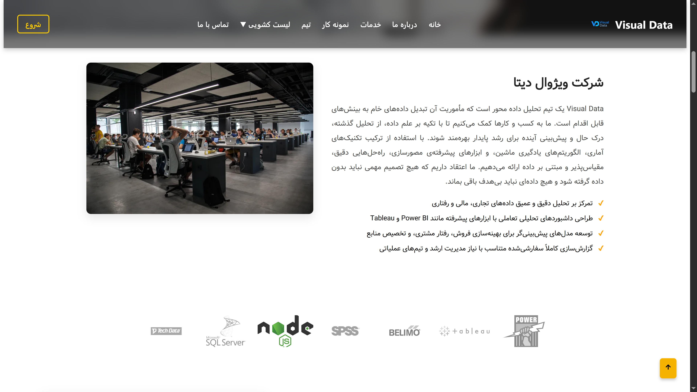
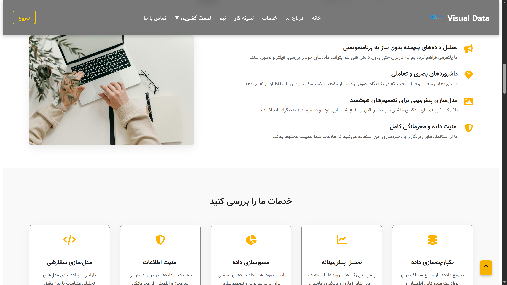
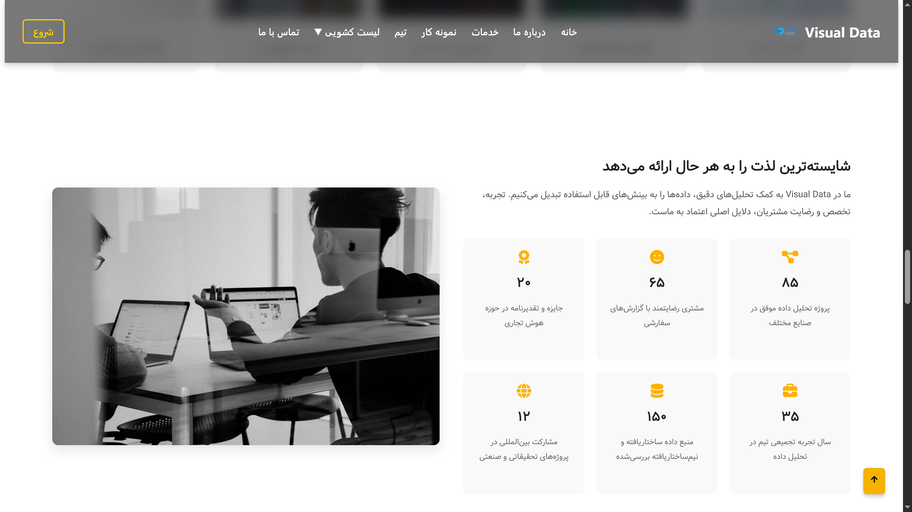
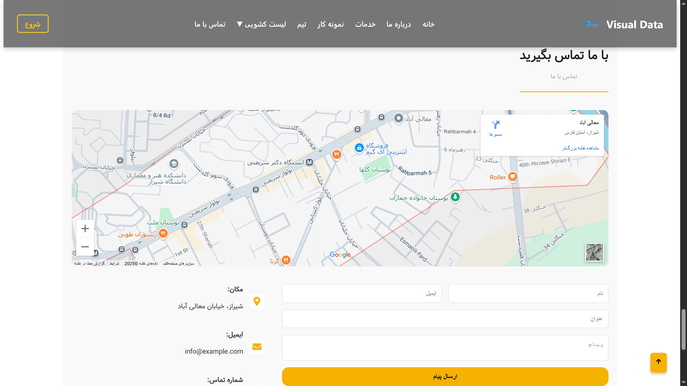
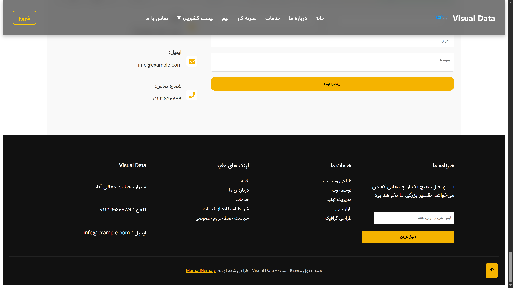

# 📊 Visual Data

A responsive, component-based website for a fictional data analytics company, built with React.

[🔗 Live Demo](https://mamadnematy.github.io/Visual-Data/) · [🐞 Report a Bug](https://github.com/MamadNematy/Visual-Data/issues)

---

## 📖 About

Visual Data is a front-end practice project that models the website of a data-driven company. It was built to practice designing a real-world, component-based UI with React, structuring a front-end codebase cleanly, and delivering a fully responsive experience across devices.

## ✨ Features

- Component-based architecture – pages are composed from reusable React components
- Responsive design – optimized for mobile, tablet, and desktop screens
- Client showcase slider – a smooth, touch-friendly carousel powered by Swiper.js
- Realistic company structure – multi-section layout that mirrors a real data analytics business
- Clean project organization – clear separation of files and responsibilities

## 🛠️ Tech Stack

| Category | Technologies |
| --- | --- |
| Library | React.js |
| Language | JavaScript (ES6+) |
| Markup & Styling | HTML5, CSS3 |
| UI Components | Swiper.js |
| Tools | Git, GitHub |

## 🖼️ Gallery

Click to view more screenshots

 

  
  
  

  
  
  

  
  

## 🚀 Getting Started

### Prerequisites

- [Node.js](https://nodejs.org/) (LTS version recommended)
- npm (comes with Node.js)

### Installation

# Clone the repository
git clone https://github.com/MamadNematy/Visual-Data.git

# Navigate to the project directory
cd Visual-Data

# Install dependencies
npm install

# Start the development server
npm start
The app will be available at http://localhost:3000 (or the port shown in your terminal).

## 🎯 What I Practiced

- Building page layouts from reusable, component-based React code
- Integrating a third-party library (Swiper.js) for a polished slider
- Responsive design across mobile, tablet, and desktop breakpoints
- Organizing a front-end project with a clear file structure

## 👤 Author

Mamad Nematy

## 📄 License

This project is licensed under the [MIT License](LICENSE).
